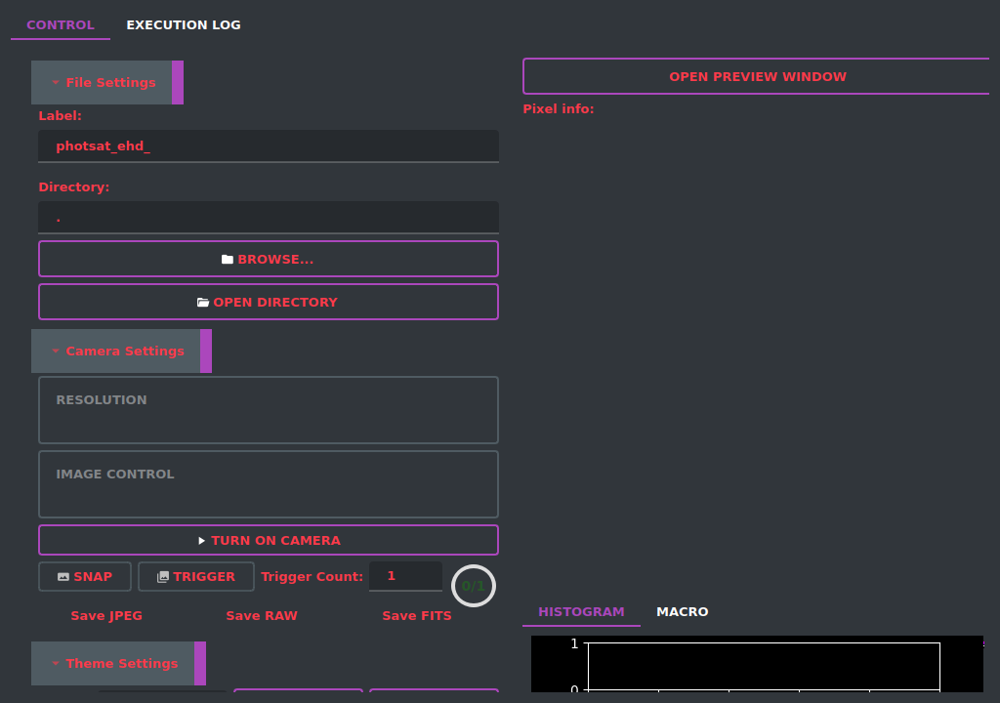
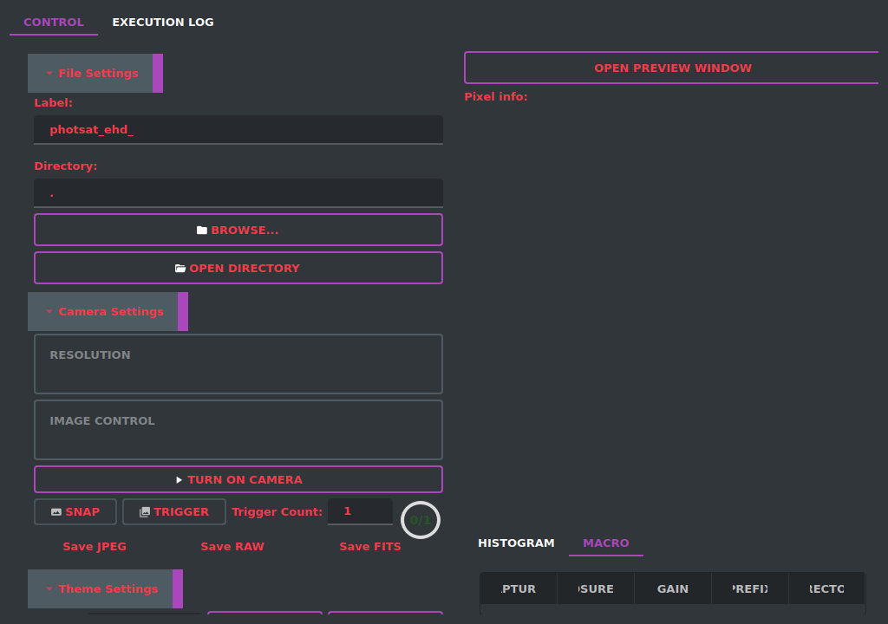
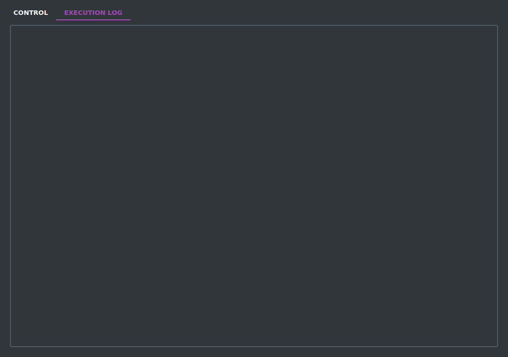

# Photsat EHD Camera Controller

A professional PyQt5-based graphical user interface for controlling EHD cameras. This application provides comprehensive camera control, live preview, automated macro capture sequences, and advanced image processing capabilities for scientific and industrial imaging applications.



## Overview

The Photsat EHD Camera Controller is designed for precise control of EHD-compatible cameras, offering features such as manual exposure and gain control, multiple image format output (JPEG, RAW, FITS), real-time histogram visualization, and automated macro capture sequences. The application supports both continuous preview mode and triggered capture modes, making it suitable for various imaging workflows.

## Key Features

### Camera Control
- Automatic camera detection and enumeration
- Support for multiple camera resolutions
- Manual exposure time control (microseconds)
- Manual gain adjustment (percentage)
- Auto-exposure mode
- Temperature monitoring
- Real-time frame rate display
- Image flip controls (horizontal and vertical)

### Image Acquisition
- Snap mode for single image capture
- Trigger mode for sequential captures with progress tracking
- Support for multiple output formats:
  - JPEG for preview and general use
  - RAW binary format for maximum data retention
  - FITS format with comprehensive metadata headers
- Configurable file naming with custom prefixes
- Selectable output directory

### Live Preview
- Real-time camera preview with aspect ratio preservation
- Pixel value inspection with mouse hover
- Independent preview window support
- Grayscale visualization optimized for scientific imaging

### Macro Capture Mode
- Define multi-step capture sequences
- Configure individual exposure, gain, and capture count per step
- CSV import/export for sequence management
- Automated execution with progress tracking
- Per-step directory and file prefix configuration



### Histogram Analysis
- Real-time histogram display
- Supports 8-bit and 16-bit image data
- Intensity distribution visualization
- Dark background optimization for scientific analysis

### User Interface
- Modern, customizable themes (dark and light variants)
- Collapsible sections for efficient workspace management
- Customizable text color
- Integrated execution log viewer
- Professional design suitable for laboratory environments



### FITS Metadata
The application automatically embeds comprehensive metadata in FITS files:
- Exposure time (EXPTIME)
- Gain settings (GAIN)
- Camera temperature (TEMP)
- Image dimensions (WIDTH, HEIGHT)
- Bit depth (BITDEPTH)
- Camera model (CAMERA)
- Statistical data (mean, median, standard deviation, min, max)
- Capture timestamp (CAPTIME)

## Prerequisites

### Linux Systems
Before using this software on Linux, you need to configure USB device permissions:

1. Create a file named `99-ehdcam.rules` with the following contents:

```bash
# EHD Camera USB permissions
# Copy this file to /etc/udev/rules.d/

# Once done, unplug and re-plug your device. This is all that is
# necessary to see the new permissions. Udev does not have to be restarted.

SUBSYSTEM=="usb", ATTRS{idVendor}=="0547", MODE="0666"
```

2. Copy the file to `/etc/udev/rules.d/`:
```bash
sudo cp 99-ehdcam.rules /etc/udev/rules.d/
```

3. Unplug and re-plug your camera device to apply the new permissions.

### Windows Systems
On Windows, install **EHDViewLite** from the [EHD website](https://www.ehd.de/driver/) to ensure proper driver installation.

## Installation

### 1. Clone the Repository

```bash
git clone https://github.com/dot-gabriel-ferrer/Camera_Control_Photsat.git
cd Camera_Control_Photsat
```

### 2. Install Python Dependencies

All required Python packages are listed in `requirements.txt`:

```bash
pip install -r requirements.txt
```

Dependencies include:
- PyQt5 >= 5.15.0 (GUI framework)
- qt_material >= 2.8.0 (Material Design themes)
- qtawesome >= 1.2.0 (Icon library)
- numpy >= 1.18.0 (Numerical processing)
- matplotlib >= 3.1.0 (Histogram visualization)
- astropy >= 4.0.0 (FITS file handling)

### 3. Configure Camera Library

**Linux:**
Ensure that `libnncam.so` is located in the `nncam/` directory or in your system library path.

**Windows:**
The `nncam/` directory should contain the appropriate Windows DLL file (e.g., `libnncam.dll`).

## Usage

### Starting the Application

Run the main application script:

```bash
python main.py
```

The application window will open with two main tabs: Control and Execution Log.

### Basic Workflow

1. **Connect Camera**: Click "Turn On Camera" to detect and initialize connected EHD cameras.

2. **Configure Settings**:
   - Select desired resolution from the dropdown menu
   - Set exposure time in microseconds
   - Set gain percentage
   - Choose output formats (JPEG, RAW, FITS)
   - Configure file prefix and output directory

3. **Capture Images**:
   - **Snap**: Capture a single image
   - **Trigger**: Capture multiple images sequentially (set trigger count)

4. **View Results**:
   - Real-time preview displays in the main window
   - Histogram updates automatically
   - Check execution log for detailed information

### Macro Mode Operation

1. Navigate to the Macro tab in the right panel
2. Click "Add Row" to create a capture step
3. Configure each step:
   - Captures: Number of images to capture
   - Exposure (us): Exposure time in microseconds
   - Gain: Gain percentage
   - Prefix: File name prefix for this step
   - Directory: Output directory for this step
4. Optionally save the sequence to CSV for reuse
5. Click "Start Macro Capture" to execute the sequence
6. Monitor progress via the circular progress indicator

### Theme Customization

1. Expand the "Theme Settings" section
2. Select a theme from the dropdown menu
3. Click "Apply Theme" to update the interface
4. Use "Select Text Color" to customize text appearance

## Building a Standalone Executable

### Linux

```bash
pyinstaller --onefile --windowed \
  --add-binary "nncam/libnncam.so:nncam" \
  --name PhotosatCameraControl \
  main.py
```

### Windows

```bash
pyinstaller --onefile --windowed ^
  --icon=assets/icon.ico ^
  --add-binary "nncam/libnncam.dll;nncam" ^
  --name PhotosatCameraControl ^
  main.py
```

The compiled executable will be located in the `dist/` directory.

## Application Architecture

The application follows a modular architecture:

- `main.py`: Entry point and application initialization
- `widgets/main_widget.py`: Main window and tab management
- `widgets/control_widget.py`: Camera control interface
- `widgets/macro_widget.py`: Macro sequence configuration
- `widgets/preview_window.py`: Independent preview window
- `widgets/preview_label.py`: Custom label for image preview
- `widgets/collapsible_box.py`: Collapsible UI sections
- `widgets/circular_progress.py`: Progress indicator widget
- `utils/logging_utils.py`: Logging utilities and log display widget
- `utils/utils.py`: Helper functions and decorators
- `nncam/nncam.py`: Camera SDK interface

## Log Files

Execution logs are automatically saved to the `logs/` directory with timestamps:
```
logs/execution_log_YYYYMMDD_HHMMSS.log
```

Logs include DEBUG, INFO, WARNING, and ERROR level messages for troubleshooting and audit purposes.

## Troubleshooting

### Camera Not Detected
- Verify USB connection
- Check udev rules on Linux or driver installation on Windows
- Confirm camera is powered
- Review execution log for error messages

### Permission Denied (Linux)
- Ensure udev rules are properly installed
- Verify the vendor ID matches your camera (default: 0547)
- Unplug and re-plug the camera after installing rules

### Application Crashes on Startup
- Verify all Python dependencies are installed
- Check that PyQt5 version is compatible
- Review log files in the logs/ directory

## Contributing

Contributions are welcome. Please follow these guidelines:
- Fork the repository
- Create a feature branch
- Follow existing code style and documentation standards
- Test thoroughly before submitting
- Submit pull requests with clear descriptions

## License

This project is licensed under the MIT License. See the LICENSE file for complete details.

## Acknowledgments

This software uses the NNcam SDK for EHD camera communication and relies on several open-source Python libraries for GUI and image processing functionality.
